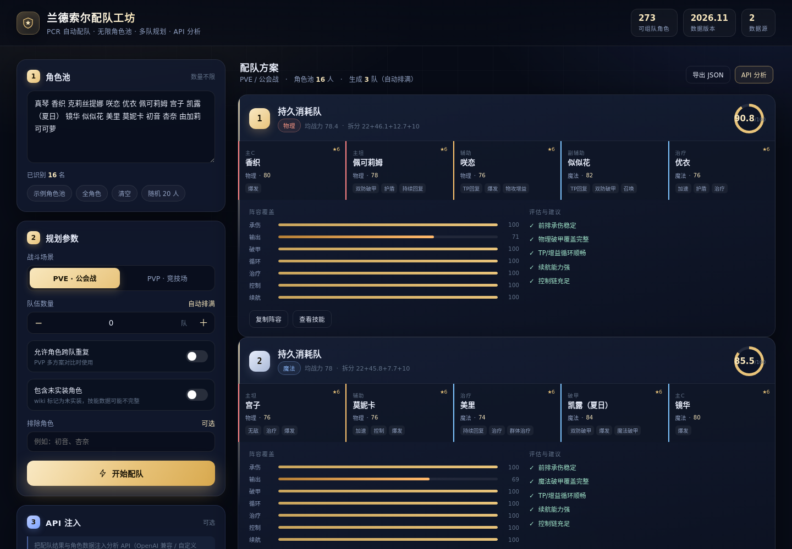
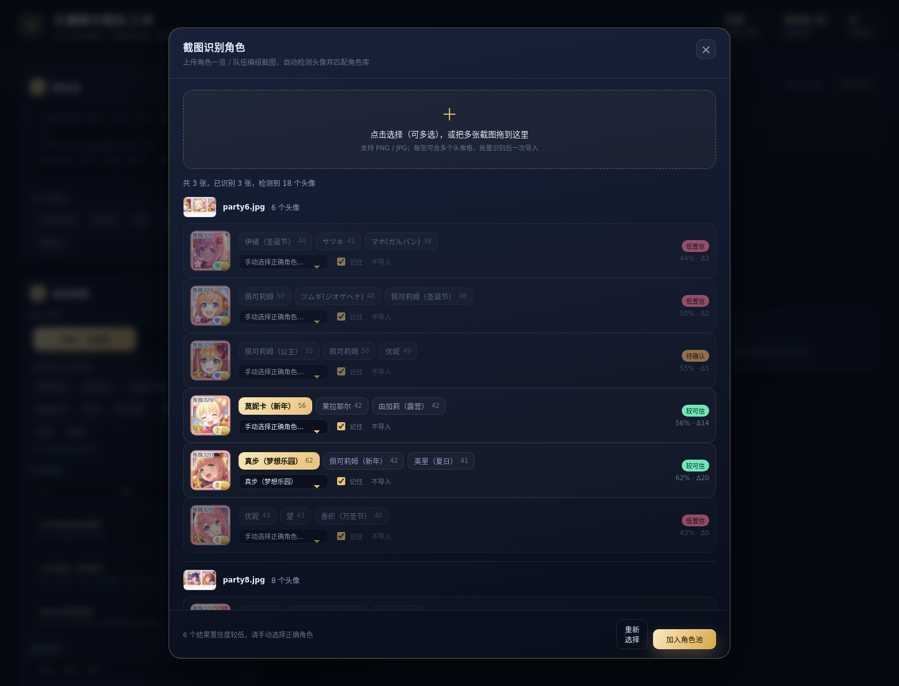
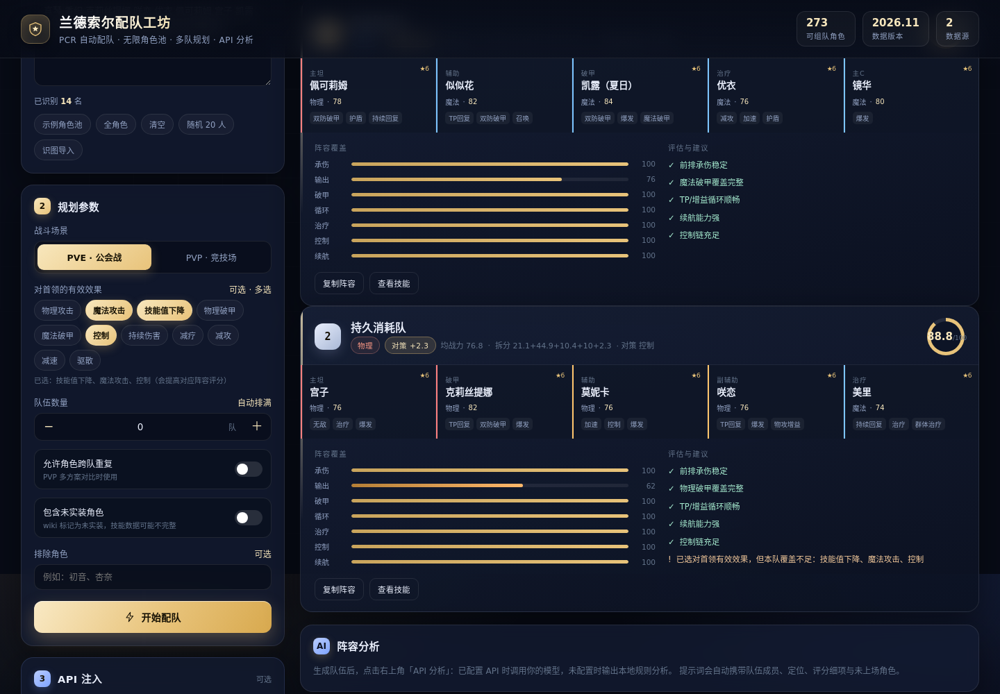
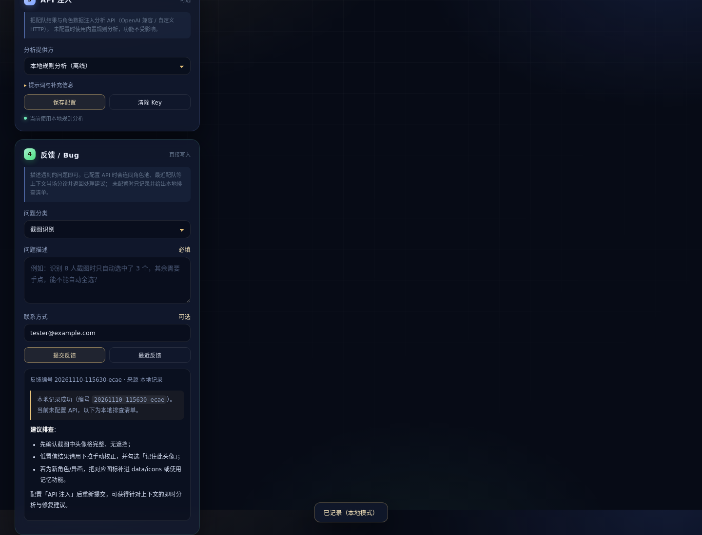

# 兰德索尔配队工坊 · PCR 自动配队器

输入你拥有的《公主连结 Re:Dive》角色（数量不限），自动搜索并输出多套最优 5 人阵容；
内置 **API 注入区块**，可接入任意 OpenAI 兼容接口或自建 HTTP 分析服务，对配队结果做二次点评。
纯 Python 标准库实现，零第三方依赖。

```
角色池（273 名已实装 / 任意子集）
        │
        ▼
┌───────────────────┐    ┌──────────────────┐    ┌──────────────────┐
│ 能力向量 / 标签    │ →  │ 束搜索 + 阵容评分 │ →  │ 多队装箱 + 局部交换 │
└───────────────────┘    └──────────────────┘    └──────────────────┘
                                    │
                                    ▼
                      Web UI / CLI / JSON / HTTP API
                                    │
                                    ▼
                        API 注入区块（LLM 或自定义分析服务）
```



---

## 1. 特性

- **日文名 / GameWith 补录**：支持用日文名（ペコリーヌ、キャル(サマー)…）输入；
  GameWith 补录的 75 名新角色（按「国服≈日服 12 个月」口径视为已实装）直接进入国服池。
- **截图导入（支持多图）**：一次选择/拖入多张角色一览截图，逐张识别、统一确认后批量导入；
  低置信度结果可手动纠正，勾选「记住」后下次自动识别。
- **对首领有效效果**：可选物理攻击 / 魔法攻击 / 技能值下降 / 破甲 / 控制 / 持续伤害等 11 种对策，
  直接参与配队评分和分析提示词。
- **无限角色池**：从 1 人到全部 **273 名已实装角色**（Wiki 共 294 页，21 名未实装默认排除，可显式开启），
  自动解析别名（`吃货`、`狼`、`水黑`、`xcw`…）。
- **三队连战（含顺序）**：一次生成 3 支不重复的队伍并标注「开局 / 承接 / 收尾」，
  适合连战 BOSS；可与「对首领有效效果」叠加。
- **无限队伍数**：`0` 表示按角色池自动排满（不允许重复时上限 = 角色数 ÷ 5）；也可指定任意队数；
  支持「角色跨队复用」做 PVP 变体对比（界面单次最多 200 队，超出请用 CLI 或 API 调整）。
- **不是随机拼凑**：每名角色被解析为 14 维能力向量（承伤 / 群奶 / 物理破甲 / 魔法破甲 / 双系输出 /
  TP / 加速 / 增益 / 控制 / 护盾…），再按「主坦 + 同属性破甲 + 输出 + 功能位 + 治疗」的覆盖模型打分。
- **多队全局优化**：先逐队贪心，再做队间成员交换（local search），把总分配拉高，并自动按分数重排。
- **可审计**：`scripts/audit_dataset.py` 以 Wiki 实时快照复核 273 名角色的字段、标签与定位，
  最近一次审计 0 高/0 中问题（见 [docs/data-audit.md](docs/data-audit.md)）。
- **反馈 / Bug 区**：用户直接写入问题；配置 API 后连同角色池、最近配队上下文即时分诊，
  未配置则本地记录并给出排查清单。
- **风险建模**：从技能文本识别自伤/自控/战斗不能（杏奈、伊莉亚、茉莉等 11 名），
  PVE 中主动规避「自杀式」阵容。
- **可解释**：每队给出分数拆分（战力 / 结构 / 协同 / 站位 / 扣分）、覆盖度条形图、短板与补强建议。
- **API 注入**：OpenAI 兼容（DeepSeek / OneAPI / vLLM / Ollama）或完全自定义 HTTP；
  未配置时自动降级为本地规则分析，功能不断档。
- **零依赖 Web 服务**：`http.server` + 原生前端，深色王室主题，手机可直接打开。

## 2. 快速开始

要求 Python ≥ 3.10，无需 `pip install`。

### Web 界面

```bash
cd pcr_team_builder
python3 -m pcr_team.server --port 8765
# 浏览器打开 http://127.0.0.1:8765
```

页面左侧粘贴角色（或点「识图导入」上传截图）→ 选择 PVE/PVP、队伍数、对首领有效效果 →
「开始配队」；右上角「API 分析」调用注入的分析接口。

### 命令行

```bash
# 基本用法：空格 / 逗号 / 换行分隔，支持外号
python3 -m pcr_team.cli "真琴 香织 克莉丝提娜 咲恋 优衣 佩可莉姆 宫子 水黑 镜华 似似花 美里 莫妮卡" --teams 2

# 全部角色、自动排满、PVP 模式
python3 -m pcr_team.cli --file my_chars.txt --teams 0 --mode pvp

# 生成 10 队并调用 API 分析，结果写入 JSON
python3 -m pcr_team.cli --file my_chars.txt --teams 10 --json out.json --analyze

# 查角色 / 查外号
python3 -m pcr_team.cli --find 吃货
python3 -m pcr_team.cli --list | head
```

常用参数：

| 参数 | 说明 |
| --- | --- |
| `--teams N` | 队伍数；`0` = 按角色池自动排满（每队 5 人） |
| `--sequence` | 三队连战：输出 3 支有顺序、不重复的队伍 |
| `--mode pve/pvp` | 评分权重不同（PVP 更看重控制与爆发） |
| `--allow-reuse` | 允许角色跨队重复 |
| `--exclude "初音,杏奈"` | 排除角色 |
| `--beam 600` | 束搜索宽度，越大越准、越慢 |
| `--include-unreleased` | 把 Wiki 标记未实装的角色也纳入（数据可能不完整） |
| `--enemy-effects "物理攻击,技能值下降"` | 对首领的有效效果，参与评分 |
| `--json out.json` | 导出完整结构化结果 |
| `--analyze` | 调用 API 注入区块（未配置则本地分析） |

## 3. 输入格式

- 分隔符：空格、逗号、中文顿号、分号、换行、`|`、`/`。
- 名称：官方译名、页面名、`外号`、日文名/片假名（ペコリーヌ、キャル(サマー)）与内置昵称。
- 变体写作 `角色（形态）`，如 `凯露（夏日）`、`佩可莉姆（公主）`；也接受半角括号。
- 模糊匹配：输入包含关系且长度 ≥ 2 时尝试匹配（如「泳装凯露」）。
- 无法识别的名字会被忽略，并在 Web / CLI 中提示。

## 4. 配队算法

### 4.1 能力向量

由技能文本（UB / 6★UB / 技能1 / 技能2 / 专武 / 二专）按句式与作用域（自身 / 我方 / 敌方）抽取标签，
再折算为能力值。抽取规则覆盖「降低/下降/削弱/减少」等同义词、「物理/魔法防御力」等混合写法，
并排除否定句（如「不会恢复技能值」）与说明性文字（如「除非目标为无敌」）：

| 能力 | 来源 | 说明 |
| --- | --- | --- |
| `tank` | 前卫 + 嘲讽 / 减伤 / 护盾 / 自愈，或定位为坦克 | 主坦 1.0，副坦按评分衰减 |
| `heal` | 群体治疗 1.0 / 单体 0.55 / 仅自身 0.18 | 只有群奶能填满治疗缺口 |
| `shred_phys` / `shred_magic` | 敌方防御力下降 | 破甲类型必须与输出类型一致 |
| `dps_phys` / `dps_magic` | 技能倍率 + 是否主力输出 | 由 `power` 归一化 |
| `tp` / `haste` | 回复技能值 / 行动速度提升（我方） | TP 循环 |
| `buff_p` / `buff_m` | 我方物攻 / 魔攻提升 | 增益 |
| `control` | 眩晕 / 束缚 / 冰冻 / 魅惑… | PVP 权重更高 |
| `sustain` | 群奶或持续回复 | 长线续航 |

角色强度 `power` 由「技能倍率 + 6★ + 专武 + 初始星级 + 限定」结构式估算，
并可在 `pcr_team/data/meta.json` 的 `tier_overrides` 中逐角色覆盖。

### 4.2 阵容评分（0–99）

```
总分 = 战力分(22) + 结构分(50) + 协同分(≤14) + 站位分(10) − 扣分
```

- **结构分**：7 项覆盖度 `sat = min(1, 聚合能力 / 需求)`，按模式权重加权：
  PVE → 输出 16 / 承伤 12 / 破甲 12 / 循环 7 / 治疗 7 / 续航 3 / 控制 2；
  PVP → 输出 15 / 控制 13 / 承伤 11 / 循环 9 / 破甲 8 / 治疗 3 / 续航 2。
- **协同分**：破甲 × 同系输出、TP × 主 C、主坦 × 输出、治疗 × 主坦等配对加分（单对封顶 7），
  加上同系一致性奖励；人工确认的经典组合见 `synergy_pairs`。
- **扣分**：无主坦 / 无群奶 / 混伤且破甲不匹配 / 双主坦 / 双群奶 / 输出位 ≥ 4 / 五后卫 等。

### 4.3 搜索与多队

1. 候选裁剪：全局强度前 70 + 各能力（坦/奶/双破甲/双系输出/TP/加速/控制/续航）前 16，最多 140 人。
2. 束搜索：组合按索引递增枚举（消除排列重复），部分状态带「覆盖度先验」，逐层保留 `beam` 个状态，
   最后两层自动加宽，避免均衡阵容在叶子前被误剪。
3. 锚点补搜：纯输出角色（如镜华）容易在部分分中被辅助角色挤掉，额外以 10 个角色锚点
   （双系输出/坦/奶/破甲/TP）各自做一次小束搜索，把「以某核心建队」的最优解并入候选。
4. 全量重打分：对最终状态计算完整阵容分并排序；多队时保护第一队不被装箱交换拉低。
4. 多队：逐队取最优 → 移除已用角色 → 继续；随后在队间做成员交换（每对队伍 25 种交换），
   以「总分之最大」迭代改进，最后按分数重排名次。
5. `--allow-reuse`：同池生成多套差异阵容（重叠 ≤ 4 人），用于 PVP 方案对比。
6. `--sequence`：固定 3 队、角色不重复，按强度降序标注「第1队·开局 / 第2队·承接 / 第3队·收尾」，
   总评 = 三队分数之和；每队仍单独计算对首领效果匹配（`enemy_fit`）。

单队约 **1.6 秒**、5 队约 **5.6 秒**（273 名角色，含首发锚点补搜；普通笔记本）。

## 5. 数据来源与构建

| 来源 | 用途 |
| --- | --- |
| [biligame 公主连结 Wiki](https://wiki.biligame.com/pcr/首页) | 294 页角色资料，其中 273 名已实装（站位、攻击方式、星级、限定、专武、全部技能文本） |
| [兰德索尔图书馆 pcredivewiki.tw](https://pcredivewiki.tw/) | 角色/环境交叉参考，配队体系与术语校验 |
| [KKeyfun/pcr-lookup-assets](https://github.com/KKeyfun/pcr-lookup-assets) | 272 张角色图标（截图识别用） |
| [pcrdfans](https://www.pcrdfans.com/) | 角色图鉴页与 sprite 表（识别辅助/名称映射） |
| [GameWith プリコネ攻略wiki](https://gamewith.jp/pricone-re/) | 日文名/别名、补录 75 名新角色、角色定位/站位/技能与 347 张图标 |

抓取与构建（可复现）：

```bash
python3 scripts/scrape_biligame.py   # MediaWiki API，断点续传，限速
python3 scripts/build_dataset.py     # 解析 wikitext → characters.json（标签/定位/能力）
python3 scripts/enrich_gamewith.py   # 合并 GameWith 日文名/日服角色/日服图标（需先缓存 research2/gw_rows.json）
```

产物：

- `pcr_team/data/characters.json`：369 条记录 = 国服 Wiki 294 条（273 已实装 + 21 未实装）+ GameWith 补录 75 名；
  含日文名/别名、技能（新角色为日文原文）、标签、定位与 `source` 字段。引擎默认加载 348 名可组队角色。
- `pcr_team/data/raw_wikitext.json`：原始 wikitext 快照（可离线重建）。
- `pcr_team/data/meta.json`：人工调参层（强度覆盖、协同对、别名消歧）。

> 数据版本见 `meta.json.version`（当前 2026.11）。新角色上线后重跑两条脚本即可，
> 规则抽取失败时会在构建日志中列出「无标签角色」，可手工补充或加入 `ROLE_OVERRIDE`。

## 6. 数据审计

`scripts/audit_dataset.py` 以 Wiki 实时快照为基准做独立审计（不信任本地缓存）：

```bash
python3 scripts/audit_dataset.py            # 使用本次抓取快照
python3 scripts/audit_dataset.py --refresh  # 重新抓取全部 294 页后再审计
```

检查项：页面完整性、5 个核心字段 + UB 名、实装标记、ID/名称唯一性、1175 个标签实例的文本依据、
12 类关键词漏判扫描、坦克/治疗/破甲/输出定位一致性、meta 引用悬挂。

**最近一次结果**（见 [docs/data-audit.md](docs/data-audit.md)）：

- 高优先级 **0**，中优先级 **0**，低优先级 **2**（Wiki 本身缺字段的未实装角色页）；
- 核心字段差异 0，未实装标记差异 0，标签无依据 0，定位异常 0；
- 本轮据此完成：21 名未实装角色默认剔除、别名短名误匹配修复、破甲/治疗/无敌/持续回复/TP 的
  同义词与作用域修正、23 名输出角色技能倍率修复。

## 7. 模型校准

`scripts/calibrate.py` 会跑一组基准阵容并输出 [docs/calibration.md](docs/calibration.md)：

```bash
python3 scripts/calibrate.py
```

最近一次校准（2026-11）：

| 项目 | 结果 |
| --- | --- |
| 技能倍率 | 只取「×攻击力」，异常值 180 修复为上限 24 |
| 风险角色 | 11 名（杏奈 risk=1.0、茉莉（狂野）/初音（夏日）0.8…） |
| PVE 正面基准 | 81.4–87.9 |
| PVE 反面样例 | 10.1–78.1（五输出 44.2、五辅助 10.1、无破甲混伤 78.1） |
| PVP 正面基准 | 75.2–81.6，反面 55.1–60.5 |
| 搜索质量 | 普通束 88.9 → 加锚点 **92.6**（+3.7） |

回归测试见 `tests/test_calibration.py`：正面阵容不低于 80 分、五辅助不高于 30 分、
锚点搜索必须优于普通束搜索、PVE 最佳队不得包含自杀角色。

## 8. 截图识别角色

上传角色一览 / 队伍编组截图（支持多选/多张拖入），自动导入角色。



```bash
python3 scripts/scrape_icons.py   # 首次：下载 272 张角色图标
```

**管线**（`pcr_team/recognition.py`，OpenCV + Pillow）：

识别库 = 609 张国服图标（272 名，含稀有度变体）+ 347 张 GameWith 图标，共 347 个可识别角色名。

1. **头像格检测**：饱和度掩膜去掉白色背景，闭运算后找轮廓，筛掉非方形区域，
   去重叠并按阅读顺序排序（支持多行截图）。
2. **头像预处理**：裁掉四周 8%–10%（等级、星级、属性角标），缩放到 128×128。
3. **两阶段匹配**：先用主图标做单尺度快筛（347 个角色），再对 Top-50 用全部稀有度变体
   做多尺度模板匹配 + HSV 颜色直方图，得分 = `0.7×模板 + 0.3×颜色`，输出 Top-3 与 margin。
4. **多图队列**：前端逐张上传识别，结果按图片分组展示，统一勾选后一次性写入角色池；
   服务启动时会预热识别库，避免首次上传等待。
4. **确认与记忆**：按 margin 标注「较可信 / 待确认 / 低置信」；低置信时提供全角色下拉手动纠正。
   勾选「记住此头像」后，校正样本会写入 `data/icons_custom/`，下次同一客户端立绘可直接自动识别
   （实测校正一次后 Top-1 置信度 97%–98%）。

```bash
curl -X POST http://127.0.0.1:8765/api/recognize \
  -H 'Content-Type: application/json' \
  -d '{"image": "data:image/png;base64,...", "topk": 3}'
```

返回 `cells[]`（`bbox`、`candidates[]`、`confidence`、`margin`）与 `library` 数量；
启动预热后单张 6–8 人截图约 1–2 秒，3 张批量约 4–5 秒。图标库覆盖 347 个角色名（国服 + GameWith 补录），新角色/异画会落到低置信，
此时手动选择即可；勾选「记住此头像」后只需校正一次，后续截图即可自动识别。

## 9. 对首领的有效效果

对应游戏「队伍编组 → 对首领的有效效果」，支持多选（11 种）：



| 效果 | 引擎判定 |
| --- | --- |
| 物理攻击 / 魔法攻击 | 按队伍物理/魔法输出占比给分（0–4） |
| 技能值下降 | 削 TP 角色覆盖（0–3） |
| 物理破甲 / 魔法破甲 | 对应破甲覆盖（各 0–2） |
| 控制 | 眩晕/束缚/击退等（0–2） |
| 持续伤害 | 中毒/灼烧（0–2） |
| 减疗 / 减攻 / 减速 / 驱散 | 对应 debuff 覆盖（0–2） |

- 合计上限 **+12 分**，写入 `breakdown.enemy`，队伍卡显示「对策 +X」；
- 覆盖不足时提示「已选对首领有效效果，但本队覆盖不足」；
- 所选效果进入 API 分析提示词，要求逐项说明如何利用；
- CLI：`--enemy-effects "物理攻击,技能值下降"`；HTTP：`/api/plan` 的 `enemyEffects` 数组。

## 10. 反馈 / Bug

界面侧栏底部「反馈 / Bug」：直接写问题描述，提交时自动附带运行上下文
（角色池、模式、最近一次配队、识图结果、页面与浏览器信息）。



- **已配置 API**：当场调用模型分诊，返回「问题归类 / 复现条件 / 原因推测 / 临时规避 / 修复建议」；
- **未配置 API**：写入 `data/feedback.json`，并给出本地排查清单；
- API 调用失败自动回退本地清单，不会丢反馈；
- 「最近反馈」可查看历史记录（编号、分类、分析来源、摘要）。

```
POST /api/feedback   {text, category, contact?, context?}
GET  /api/feedback?limit=20
```

反馈最多保留最近 500 条，保存在本地 `pcr_team/data/feedback.json`（已在 .gitignore 中忽略）。

## 11. API 注入区块

配置保存在项目根目录 `config.json`（也可用环境变量 `PCR_CONFIG` 指向别处）。
Web 页面「③ API 注入」可直接编辑并保存；密钥只写本地文件，接口返回时始终掩码。

### 6.1 OpenAI 兼容（DeepSeek / OpenAI / vLLM / Ollama / OneAPI）

```json
{
  "provider": "openai",
  "base_url": "https://api.deepseek.com/v1",
  "api_key": "sk-...",
  "api_key_env": "PCR_LLM_API_KEY",
  "model": "deepseek-chat",
  "temperature": 0.4,
  "max_tokens": 1500,
  "timeout": 90,
  "system_prompt": "你是一位《公主连结Re:Dive》资深配队顾问……",
  "extra_context": "台服 2026-11 环境；真琴 5★ 专武；BOSS 会沉默前排"
}
```

- 请求 `POST {base_url}/chat/completions`，标准 `messages` 结构。
- `api_key` 为空时读取环境变量 `api_key_env`（默认 `PCR_LLM_API_KEY`）。
- Ollama 示例：`base_url = http://127.0.0.1:11434/v1`，`model = qwen2.5:7b`，key 随便填。

### 6.2 自定义 HTTP 注入

```json
{
  "provider": "custom",
  "custom": {
    "url": "http://127.0.0.1:9000/analyze",
    "headers": { "Content-Type": "application/json", "X-Token": "..." },
    "body_template": "{\"prompt\": {{prompt_json}}, \"system\": {{system_json}}}",
    "response_path": "data.answer"
  }
}
```

- 模板占位符：`{{prompt_json}}`（JSON 转义后的提示词）、`{{system_json}}`、`{{prompt}}`。
- `response_path` 为点号路径，支持数组下标，如 `choices.0.message.content`。
- 返回体必须能取到非空字符串，否则自动回退本地分析并在响应中带上 `error`。

### 6.3 注入的提示词包含什么

- 模式、角色池规模、每队定位/评分/覆盖度/模型提示；
- 未上场角色（可作为替换候选）；
- 用户补充信息（版本、练度、BOSS 机制）；
- 固定的输出结构要求（结论 / 逐队点评 / 替换 / 操作 / 培养）。

可通过 `system_prompt` 与 `extra_context` 完全改写分析口径。

### 6.4 无 Key 时的本地分析

`provider = "local"`（默认）不联网，输出确定性的规则分析：逐队定位、优势、短板、替换建议与总体思路。
API 调用失败（超时、401、返回为空）也会回退到这里，并在结果里说明原因。

## 12. HTTP API

启动：`python3 -m pcr_team.server --port 8765`

| 方法 | 路径 | 说明 |
| --- | --- | --- |
| GET | `/api/characters` | 已实装角色（名称/站位/攻击/定位/标签/别名）；`?all=1` 含未实装并带 `playable` |
| GET | `/api/meta` | 角色数、数据版本、来源 |
| GET | `/api/config` | 当前配置（Key 掩码） |
| POST | `/api/config` | 保存配置 |
| POST | `/api/plan` | 生成配队（支持 `enemyEffects`、`sequence`、`includeJp`） |
| POST | `/api/analyze` | 调用注入的分析 |
| POST | `/api/recognize` | 截图识别角色（base64/dataURL） |
| POST | `/api/feedback` | 提交反馈（可选即时 AI 分诊） |
| GET | `/api/feedback` | 最近反馈列表 |

```bash
curl -X POST http://127.0.0.1:8765/api/plan \
  -H 'Content-Type: application/json' \
  -d '{"characters":"真琴 香织 咲恋 优衣 佩可莉姆 水黑 镜华 美里","teams":2,"mode":"pve","includeUnreleased":false}'
```

`/api/plan` 关键字段：`teams[]`（`score`、`archetype`、`members[]`、`breakdown.coverage`、
`notes`、`suggestions`）、`unused`、`unknown`、`pool_size`。

```bash
curl -X POST http://127.0.0.1:8765/api/analyze \
  -H 'Content-Type: application/json' \
  -d '{"plan": {...上一步返回...}, "config": {"provider": "openai"}}'
```

返回：`source`（`openai` / `custom` / `local` / `local-fallback`）、`text`（Markdown）、`model`、`usage`、`elapsed`。

## 13. 项目结构

```
pcr_team_builder/
├── pcr_team/
│   ├── engine.py          # 能力向量、评分、束搜索、多队装箱
│   ├── analyzer.py        # 提示词构建、OpenAI/自定义 API、本地分析
│   ├── recognition.py     # 截图头像检测 + 图标匹配
│   ├── feedback.py        # 反馈存储与即时分诊
│   ├── cli.py             # 命令行
│   ├── server.py          # 零依赖 HTTP 服务
│   ├── data/
│   │   ├── icons/           # 272 张国服角色图标
│   │   ├── icons_gw/        # 347 张 GameWith 图标
│   │   ├── characters.json
│   │   ├── meta.json      # 强度覆盖 / 协同对 / 别名消歧
│   │   └── raw_wikitext.json
│   └── web/               # index.html / style.css / app.js
├── scripts/
│   ├── scrape_biligame.py
│   ├── build_dataset.py
│   ├── audit_dataset.py     # Wiki 对照审计
│   ├── calibrate.py         # 基准阵容 / 搜索质量校准
│   ├── scrape_icons.py      # 国服角色图标库下载
│   └── enrich_gamewith.py   # 合并 GameWith 日文名/日服角色/图标
├── tests/
│   ├── test_engine.py
│   ├── test_server.py
│   ├── test_api_injection.py
│   ├── test_calibration.py
│   ├── test_recognition.py
│   ├── test_enemy_effects.py
│   └── test_feedback.py
├── config.json            # API 注入配置（含密钥，勿提交）
└── README.md
```

## 14. 测试

```bash
python3 -m unittest discover -s tests -v
```

共 **53** 个测试。覆盖：角色库完整性 / 未实装过滤 / 别名与短名消歧 / 输入格式 / 队伍互斥 /
自动排满 / 复用模式 / 确定性 / PVP 控制权重 / 全角色性能 / 标签抽取（破甲、群奶、主坦、TP）/
本地分析 / OpenAI 与自定义注入 / HTTP 接口 / 校准基准与搜索质量回归 /
截图识别（合成图 Top-1、头像格检测）/ 首领有效效果（物理/魔法/削 TP）/ 日文名与日服角色开关 / 双人角色名解析 / 三队连战顺序 / 反馈存储与 AI 分诊。

## 15. 调参与扩展

`pcr_team/data/meta.json`：

```json
{
  "version": "2026.11",
  "tier_overrides": { "真琴": 80, "凯露（夏日）": 84 },
  "synergy_pairs": [["真琴", "香织", 4.0]],
  "alias_overrides": { "xcw": "镜华" }
}
```

- **强度**：`tier_overrides` 直接覆盖结构式 `power`（0–100），适合按版本梯度修正。
- **协同**：`synergy_pairs` 为人工确认组合，第三项是加分值（单对总分封顶 7）。
- **别名冲突**：如 `xcw` 同时被镜华与露娜使用，用 `alias_overrides` 指定默认。
- **模式权重**：`engine.PROFILES` 中调整 PVE/PVP 的权重与需求阈值。
- **抽词规则**：`scripts/build_dataset.py` 顶部 `RULES` 表；新增句式后重跑构建即可。

## 16. 局限与说明

- 评分是**启发式**的：用于同一角色池内横向比较与方案筛选，不等同于实战绝对强度；
  角色练度、星级、专武、BOSS 机制、操作水平都会显著影响结果。
- 标签由技能文本自动抽取，个别角色（尤其是新角色、联动角色、描述不规范页面）可能偏差；
  构建脚本会列出「无标签角色」，`roles` 也可在 `build_dataset.py` 的 `ROLE_OVERRIDE` 中修正。
- GameWith 补录的 75 名新角色技能为日文原文、名称暂无官方中文；标签由日文关键词抽取，强度按 GameWith 评分估算。
- 截图识别依赖本地图标库：新角色、异画皮肤或非本作素材会低置信，需要手动确认；
  未做 OCR 名称识别与多语言 UI 适配。
- 未建模：具体数值面板、UB 循环帧、命中/暴击、属性克制、召唤物占位、PVP 防守阵容 AI。
- 游戏数据版权归 Cygames 所有；本项目仅用于学习与配队辅助，不做商业用途。
